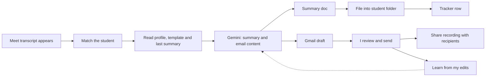

# Post-lesson workflow

An automation I built for my maths tutoring practice. After every online lesson it writes the lesson record, files everything, and drafts the follow-up email to the student and parent. I read the draft, edit it if needed, and press send.

It runs on Google Apps Script and the Gemini API, inside my own Google Workspace account, and is in daily use.

## The problem

Each lesson used to end with a block of admin: write up what we covered, file the recording and transcript, update my tracker, and email the student and their parent. With several lessons a day, that work either ate the evening or did not get done.

## What it does

Every ten minutes the script looks for new Google Meet transcripts. For each one it:

1. **Works out which student it is** from the attendee names and the meeting title.
2. **Reads the context**: the student's profile, my summary template and the previous lesson summary.
3. **Asks Gemini** for two things in one structured reply: the filled-in lesson summary and the content of the follow-up email.
4. **Creates the summary** as a Google Doc.
5. **Files everything** (summary, transcript, recording, chat, whiteboard PDF) into the student's folder for that date.
6. **Adds a row** to my lesson tracker.
7. **Leaves a draft in Gmail**, addressed to the student with the parent in cc, with the whiteboard attached.
8. **Emails me a confirmation** with links and anything I should act on.

## Design decisions

These are the choices I would point to if you asked how I think about building with AI.

**A person sends every email.** The script only ever creates a draft. An email about a child goes out under my name, so I read each one first.

**Addresses never come from the AI.** The student's and parent's email addresses are read from the profile document by plain code. The model writes the words; it does not choose who receives them.

**Private notes stay private.** The summary has a "flags" section for things only I should see, such as a worry a student raised. The prompt forbids anything from that section, and any medical or support-needs detail in the profile, from appearing in the email.

**Files are shared only after I send.** The recording and transcript are linked in the draft, but nobody gets access until the email has gone. The script then shares them with the people I sent it to, and only the files whose links I left in.

**It learns how I write.** After I send an email, the script compares what the AI drafted with what I sent, and updates a short style guide. That guide and my three most recent emails go into every later prompt, so the drafts need less editing over time.

**The model's output has a fixed shape.** Gemini must reply in a set JSON structure with named fields. The code builds the email from those fields, so formatting cannot drift.

**It assumes things will go wrong.** Calls to Gemini retry with a longer wait each time. A lesson that fails three times stops retrying and emails me the reason. A lock prevents two runs overlapping. Processed lessons are marked, so nothing is handled twice.

**Real life is messy.** Recordings arrive an hour after transcripts, or not at all. Whiteboard PDFs get saved late with odd file names. Two students can share a first name. Each of these has a rule, and when the script cannot decide it stops and asks me.

**There is a dry run.** `testFindLessons` lists what the next run would do without changing anything. I used it to test every change safely.

## What is in this repository

| File | What it is |
|---|---|
| `Code.gs` | The whole script |
| `appsscript.json` | The Apps Script settings, including the two Google services it needs |
| `examples/student-profile.example.md` | The layout of a student profile, with an invented student |
| `examples/email-draft.example.md` | What a finished draft looks like, with an invented lesson |

All student details, folder addresses and my API key have been removed. The names in comments and examples are invented.

## Running it yourself

You need a Google Workspace account with Google Meet transcripts switched on, and a Gemini API key.

1. Create a new Apps Script project and paste in `Code.gs` and `appsscript.json`.
2. In the `CONFIG` block at the top of `Code.gs`, replace each `YOUR_...` placeholder with the ID of your own folder, document or sheet, and set `ADMIN_EMAIL`.
3. In Project Settings, add a script property called `GEMINI_API_KEY` with your key. The key is never written in the code.
4. In your Students folder, create one folder per student, each with a `STUDENT PROFILE` document laid out like the example.
5. Run `testGemini`, then `testFindLessons`, to check the setup.
6. Run `installTrigger` to start the ten-minute schedule.

## What I would improve next

- **Tidy the stored state.** The script records each processed lesson in script properties and never clears old entries. That store has a size limit, so it needs a clean-up step.
- **Split the file.** One 1,100-line file was quick to build but is harder to read than it should be.
- **Add tests for the matching rules.** Matching students and whiteboard files by name is the part most likely to surprise me, and it has no automated tests.
- **Measure the edits.** The learning step changes the style guide but does not yet tell me whether my edits are getting smaller.

## How it was built

I write, test and iterate the prompts and the code myself, using Claude Code, VS Code and Google AI Studio. Every change was tested against real lessons before I relied on it.
